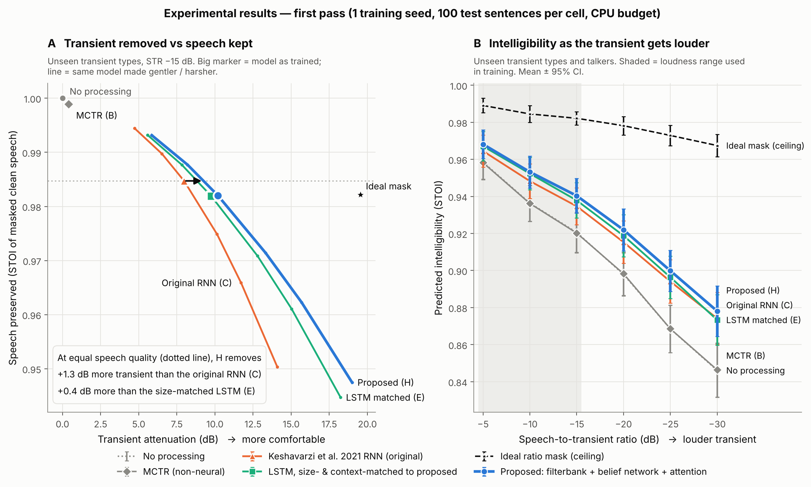
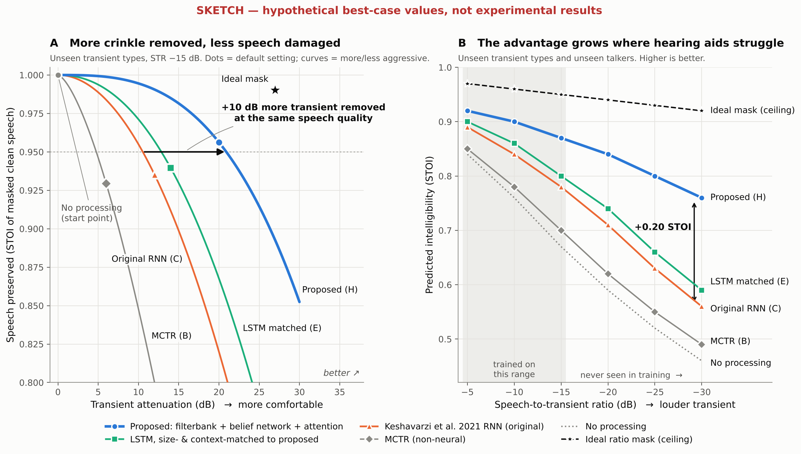

# hearing_project — belief-network + attention transient reduction

Goal: reduce crinkles, clatters and knocks for hearing-aid wearers by combining
**Keshavarzi et al. 2021** (LSTM transient-reduction mask) with **Bellur & Elhilali 2020**
(distributed belief network + memory-guided attention). Full reasoning: [`PLAN.md`](PLAN.md).

## The plan in six sentences

1. Keep Keshavarzi's 64-band gammatone "ear", since Bellur's belief network needs a spectrogram as
   its input and can't replace the filterbank.
2. Add a causal, hearing-aid-sized version of Bellur's 15-branch belief network on top of it, trained
   without labels on open everyday audio, so the network sees the sound at many time scales (up to ~0.45 s of past context).
3. Give each branch stored "memories" of speech and of transients, and use an online attention gate
   that boosts activity moving in step with speech and splits off activity that doesn't.
4. Feed the raw filterbank, the speech-coherent stream, the rejected stream and the live belief numbers
   into Keshavarzi's LSTM, which still outputs a 64-band gain mask applied to the audio with ~7.5 ms delay.
5. Train on open data (VCTK speech + FSD50K transients, mixed on the fly at −5 to −15 dB STR), holding out
   test talkers, whole transient categories, and "crumpling & crinkling" entirely.
6. Score against the original RNN, an RNN matched for size and memory, a non-neural method and the perfect
   mask, judging both how much crinkle is removed and how much speech is damaged.

## Architecture

```
waveform ─► [EAR] gammatone 64 bands (5 ms frames, 2.5 ms hop) ─┬──────────────────────────────┐
                                                                ▼                              │ skip
                                             [CORTEX] causal distributed belief network        │
                                              15 LSNs, rates 2.5–67.5 ms, context ≤ 0.45 s     │
                                                                ▼                              │
                                   [ATTENTION] speech / transient memories → coherence gate    │
                                       attended stream + rejected stream + belief numbers      │
                                                                ▼                              ▼
                                         [DECISION] stream selection → LSTM 128 → LSTM 64 → 64-band mask
                                                                ▼
                                       mask × mixture spectrum → overlap-add → output (~7.5 ms delay)
```

## Status (first pass)

| Part | Status |
|---|---|
| Stage 0–1: data (VCTK via your proposal's datashare link, FSD50K), mixing, front end, MCTR, baseline RNNs C/D, metrics | **implemented, run, results in `results/stage1/`** |
| Stage 2: causal belief network (15 sub-networks), pretraining data (LibriSpeech dev-clean + FSD50K non-transient sounds/music) | **run; weights + diagnostics in `results/stage2_3/`** |
| Stage 3: speech/transient memories (NMF) + go/no-go | **run: GO, 15/15 sub-networks separate speech from transients** |
| Stage 4: online attention, variants E/F/G/H, scoring all nine, paired statistics, ablations, money plot from data | **run, plus 3 training seeds for C/E/G/H; results in `results/stage4/`** |
| Stage 5: end-to-end fine-tuning of H (belief network + attention unfrozen) with frozen controls H_cont, E_cont | **run, 3 seeds: a gentle fine-tune does not help; H's lead over E survives more training. Results in `results/stage5/`** |
| Stage 6: longer training (C, E, H to 4,000 and 8,000 steps, same data): does H's lead hold toward convergence? | **implemented, not run** (stopped by request on 2026-11-18 after ~10 min; resumable with `python run_experiments.py stage6`) |
| Audible demo: H vs C on four held-out test sentences (`make_demo.py` → `results/demo/`) | **done** |
| Streaming deployment check, HASPI/HASQI, PESQ | not yet |

Everything runs on CPU; a GPU only makes it faster. Network hosts needed: `datashare.ed.ac.uk`, `zenodo.org`, `www.openslr.org`.

```bash
pip install -r requirements.txt
python data_download.py                     # ~30 min: VCTK subset, FSD50K eval split, pretraining audio
python run_experiments.py stage1 --smoke    # 2-minute check of the baseline pipeline on synthetic audio
python run_experiments.py stage1            # trains C and D, scores A B C D I  (~45 min CPU)
./run_pipeline.sh                           # stages 2–4 (~4 h CPU, resumable): pretrain DBN, memories, E–H, money plot
python run_experiments.py refresh4          # redo trade-off sweep / verdict / figures from saved stage-4 results
python run_experiments.py multiseed         # retrain C, E, G, H with seeds 1-2 (~3 h CPU, resumable); redraws the money plot
python run_experiments.py stage5            # fine-tune H end to end + equal-budget controls, 3 seeds (~7 h CPU, resumable)
python run_experiments.py stage6            # train C, E, H longer (to 8,000 steps), 3 seeds (~10 h CPU, resumable)
python make_demo.py                         # listening demo: WAVs + results/demo/demo.html (~2 min)
python -m pytest -q                         # 23 tests: reconstruction, STR, causality of every model, CRBM, attention
```

## Files, in the order they are used

| # | File | What it does |
|---|---|---|
| – | `config.py` | All shared numbers (frames, tree shape, attention, training, data, variants) |
| 1 | `data_download.py` | Download open datasets; talker/class splits; manifests |
| 2 | `data_mixing.py` | Make speech + transient mixtures at a given STR; frozen test set |
| 3 | `frontend_gammatone.py` | The "ear": STFT, 64-band gammatone energies, IRM, mask resynthesis |
| 4 | `baseline_mctr.py` | Non-neural comparison (variant B) |
| 5 | `dbn_crbm.py` | One causal convolutional RBM layer (+ autoencoder fallback) |
| 6 | `dbn_distributed.py` | The 15-branch belief-network tree; causal multi-rate alignment |
| 7 | `dbn_pretrain.py` | Unsupervised layer-wise pretraining + diagnostics |
| 8 | `local_memory.py` | NMF speech / transient memories per branch |
| 9 | `attention_feedback.py` | Online temporal-coherence attention gate |
| 10 | `mask_estimator_lstm.py` | The LSTM mask estimator with stream selection |
| 11 | `model_variants.py` | Wires up variants A–I |
| 12 | `train_mask_estimator.py` | Supervised training (+ optional end-to-end fine-tune) |
| 13 | `enhance_stream.py` | Real-time 2.5-ms streaming; latency and compute |
| 14 | `evaluate_metrics.py` | STOI/ESTOI, PESQ, SI-SDR, HASPI/HASQI, transient attenuation, speech preserved |
| 15 | `run_experiments.py` | The full experiment grid and ablations |
| 16 | `test_causality.py` | Tests that nothing uses future audio |
| 17 | `money_plot.py` | The headline figure: the hypothetical sketch, and the same figure drawn from real results |
| 18 | `make_demo.py` (+ `demo_template.html`) | Audible H vs C demo: picks examples by rule, writes WAVs, spectrograms and a web page |
| – | `audio_store.py` | Packs thousands of clips into one file per split (fast loading) |
| – | `synthetic_audio.py` | Fake speech/transients for smoke tests only — never results |
| – | `optim.py` | Adam + gradient clipping (from Lab 2) |
| – | `test_frontend.py`, `test_data_mixing.py`, `test_dbn.py`, `test_attention.py` | Unit tests |
| – | `run_pipeline.sh` | Runs stages 2–4 in order; resumable |

Each `.py` file opens with **PLAIN WORDS** (for a human reader). Implemented files then describe what was
built and any choices the papers left open; files for later stages still contain **PSEUDOCODE** for the
implementing agent, with stubs that raise `NotImplementedError`.

## First-pass results (CPU, 3 training seeds for the key models, 1,800 test mixtures per model)



- **The proposed model (H) beats Keshavarzi's RNN (C) on every training seed.** STOI is +0.004–0.005 better in every
  condition. On transient types never seen in training it removes +2.3 dB more transient. When both models are tuned to
  damage speech equally, it removes +0.9 to +2.6 dB more. The biggest gains are on unseen impact sounds (knocks, cutlery, hammers).
- **It also beats an LSTM of the same size and memory (E) on every seed:** +0.6 to +1.3 dB at equal speech quality
  (smallest single-seed gain +0.4 dB), and +0.002–0.004 STOI with essentially no loss of speech. The 3-seed check
  (`results/stage4/multiseed/`) was run to test exactly this, and the gain held.
- **Ablations** (`results/stage4/stage4_ablation_frontier.png`):
  - Removing the filterbank (F) makes the model *worse than the original RNN*, so the ear → cortex design is right.
  - The belief-network features alone (G) beat E by +0.2 to +0.9 dB.
  - The attention gate adds ~0.45 dB on average at equal speech quality, but not on every seed.
- **Crinkling** (grandma's complaint): H and C tie on transient removal (mean +0.3 dB, median −0.3 dB; H removes
  more on 46% of crinkling test mixtures). H's only consistent edge there is slightly better intelligibility (STOI
  +0.003–0.006). Crinkling gets the most dB removed of any test condition (~15 dB), but it is far from solved: at
  STR −15 dB the crinkle's loudest part is still about as loud as the speech after either model. The new model's
  gains are on unseen impact sounds.
- **End-to-end fine-tuning (stage 5, 3 seeds) does not help as run.** Unfreezing the belief network and attention
  ties or slightly trails the same model given the same extra steps with them frozen (−0.10 to −0.18 dB at equal speech
  quality). The fine-tune at the planned learning rate moved the belief network's weights by only 0.2%, so a stronger
  fine-tune is untested. With 2,000 extra steps for both, H still beats the size-matched LSTM on every seed (+0.55 to
  +1.06 dB), a little less than before (+0.60 to +1.34 dB). The extra steps alone are worth about as much as H's lead,
  so every model is still undertrained ([`results/stage5/README.md`](results/stage5/README.md)).
- Still far from the ideal mask (22 dB, STOI 0.980). Details and caveats: [`results/stage4/README.md`](results/stage4/README.md);
  next steps: `PLAN.md` §9.

## Money plot (sketch, made before any results)



**These are hypothetical best-case values, not results.** Panel A shows how much transient each model
removes against how much speech it damages. Panel B shows intelligibility as the transient gets louder,
past the range used in training.
